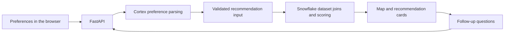

# Q-Dong · 큐동

**Personal project · Full-stack web application · AI-assisted neighborhood discovery**

Turn a natural-language description of a lifestyle and budget into neighborhood recommendations on a map of Seoul.

**Stack:** Next.js 16, React 19, Tailwind CSS, React-Leaflet, Python, FastAPI, Snowflake Snowpark, Snowflake Cortex.

[한국어 소개](README.ko.md) · [Backend implementation](backend/app/main.py) · [Security and deployment](SECURITY.md)

## What it does

- Parses Korean-language preferences into a budget, keywords, and 14 lifestyle categories.
- Joins population, apartment-price, spending, and telecom/rental datasets from Snowflake Marketplace.
- Filters neighborhoods by budget and ranks them using the selected lifestyle categories.
- Displays results on a Leaflet map with neighborhood polygons and recommendation cards.
- Supports follow-up neighborhood questions and rental-appliance insights through Cortex.

This is a recommendation prototype built around Seoul datasets. Running the data-backed features requires your own Snowflake account and access to the three datasets below; there is no shared credential in the repository.

## How it works



## Engineering decisions

| Area | Implementation and purpose |
| --- | --- |
| AI and scoring | Cortex interprets free-form input; application code computes the recommendation scores from dataset ranks. |
| Geospatial UI | GeoJSON neighborhood boundaries and Leaflet connect ranked results to their location. |
| SQL safety | Request values are bound separately from SQL; configured database identifiers are validated. |
| API boundaries | Typed request models, bounded bodies, a private demo access code, and per-process rate limits protect the data/AI endpoints. |
| Error handling | Clients receive generic failure messages rather than Snowflake exception details. |

## Run locally

Use **Python 3.11** and **Node.js 20.19+**. Commands below start from the repository root.

### 1. Backend and configuration

```bash
python3.11 -m venv .venv
source .venv/bin/activate
pip install -r backend/requirements.txt
cp backend/.env.example backend/.env
```

Fill in `backend/.env` with your own connection settings and database names:

| Variable | Dataset |
| --- | --- |
| `SNOWFLAKE_DB_RICHGO` | Korean Population & Apartment Market Price Data |
| `SNOWFLAKE_DB_SPH` | Seoul District-Level Data: Floating Population, Consumption and Assets |
| `SNOWFLAKE_DB_AJD` | South Korea Telecom Subscription Analytics: Contracts, Marketing and Call Center Insights by Region |

Use a least-privilege Snowflake role. Set `DEMO_ACCESS_TOKEN` to a randomly generated code of at least 32 characters; the browser will ask for this demo code when needed. Keep Snowflake credentials server-side.

Start the backend:

```bash
cd backend
uvicorn app.main:app --reload --host 127.0.0.1 --port 8001
```

### 2. Frontend

In a second terminal, from the repository root:

```bash
cd frontend
npm ci
npm run dev
```

Open [localhost:3000](http://localhost:3000). API documentation is available at [localhost:8001/docs](http://localhost:8001/docs).

For a remote deployment, configure `ALLOWED_ORIGINS` on the backend and `NEXT_PUBLIC_API_BASE_URL` on the frontend. Public frontend variables must never contain credentials.

## Verify

From the repository root, with the Python virtual environment active:

```bash
pip install -r requirements-test.txt
python -m pytest tests -q
```

The security tests use a fake Snowflake session and cover SQL parameter binding, invalid budgets, authentication, body limits, rate limits, and error redaction. They do not call a paid Snowflake service.

Build the frontend from `frontend/` with `npm run build`.

## API

| Method | Endpoint | Purpose |
| --- | --- | --- |
| POST | `/api/analyze-prompt` | Parse preferences with Cortex |
| POST | `/api/recommend-apartments` | Compute neighborhood recommendations |
| POST | `/api/ask-dong` | Answer a neighborhood question |
| POST | `/api/rental-insight` | Generate rental-appliance insights |

## Code map

- [backend/app/main.py](backend/app/main.py): API routes, dataset queries, and scoring.
- [backend/app/database.py](backend/app/database.py): Snowflake configuration and session creation.
- [backend/app/security.py](backend/app/security.py): access control and request boundaries.
- [frontend/src/app/components](frontend/src/app/components): search, cards, and map UI.
- [tests/test_security.py](tests/test_security.py): backend security regression tests.

See [SECURITY.md](SECURITY.md) for deployment limitations, credential handling, and the limits of per-process quotas.
